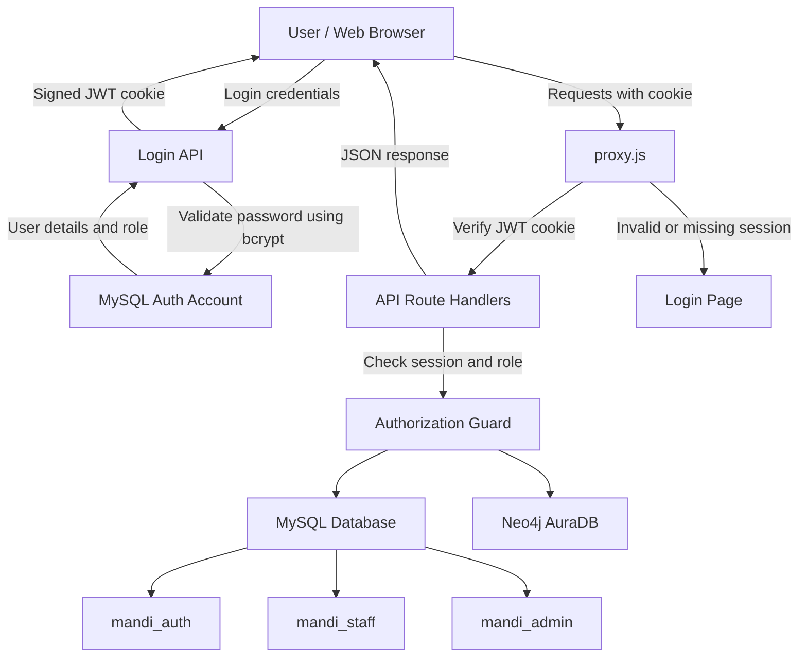

# Mandi Price Tracking System

## 7. Database Choice and Justification

The project uses two databases: **MySQL 8.4** and **Neo4j AuraDB**. Each database is selected for the type of data and operations it handles best.

## 8. Data Dictionary

The data dictionary describes the main tables used to store information in the system. The following tables are part of the core database implementation handled by Vedaraj.

### 8.1 Users

Stores login details and role information for system users.

| Attribute | Data type | Constraint | Description |
|---|---|---|---|
| user_id | INT | Primary Key, Auto Increment | Unique user identifier |
| username | VARCHAR(50) | NOT NULL, UNIQUE | Login username |
| password_hash | VARCHAR(255) | NOT NULL | Hashed user password |
| role | VARCHAR(20) | NOT NULL, CHECK | User role: Admin or Staff |

### 8.2 Farmer

Stores the basic details of farmers registered in the system.

| Attribute | Data type | Constraint | Description |
|---|---|---|---|
| farmer_id | INT | Primary Key, Auto Increment | Unique farmer identifier |
| name | VARCHAR(100) | NOT NULL | Farmer's name |
| phone | VARCHAR(15) | NOT NULL, CHECK | Farmer's phone number |
| address | VARCHAR(255) | NULL allowed | Farmer's address |

### 8.3 Farmer Contact

Stores additional contact numbers associated with farmers.

| Attribute | Data type | Constraint | Description |
|---|---|---|---|
| farmer_id | INT | Composite Primary Key, Foreign Key | References farmer(farmer_id) |
| contact_number | VARCHAR(15) | Composite Primary Key, NOT NULL, CHECK | Additional contact number |

### 8.4 Crop

Stores the details and category of crops available in the system.

| Attribute | Data type | Constraint | Description |
|---|---|---|---|
| crop_id | INT | Primary Key, Auto Increment | Unique crop identifier |
| crop_name | VARCHAR(100) | NOT NULL, UNIQUE | Name of the crop |
| category | VARCHAR(20) | NOT NULL, CHECK | Crop category: Perishable or Non-Perishable |

### 8.5 Mandi

Stores information about mandis and the users managing them.

| Attribute | Data type | Constraint | Description |
|---|---|---|---|
| mandi_id | INT | Primary Key, Auto Increment | Unique mandi identifier |
| name | VARCHAR(100) | NOT NULL | Name of the mandi |
| location | VARCHAR(150) | NOT NULL | Mandi location |
| managed_by | INT | NOT NULL, Foreign Key | References users(user_id) |

### 8.6 Sale

Stores individual crop sale transactions made by farmers at different mandis.

| Attribute | Data type | Constraint | Description |
|---|---|---|---|
| sale_id | INT | Primary Key, Auto Increment | Unique sale identifier |
| farmer_id | INT | NOT NULL, Foreign Key | References farmer(farmer_id) |
| mandi_id | INT | NOT NULL, Foreign Key | References mandi(mandi_id) |
| crop_id | INT | NOT NULL, Foreign Key | References crop(crop_id) |
| quantity | DECIMAL(12,2) | NOT NULL, CHECK | Quantity of crop sold |
| price | DECIMAL(10,2) | NOT NULL, CHECK | Sale price |
| sale_date | DATE | NOT NULL, Default: CURRENT_DATE | Date of sale |

### 8.7 Price Record

Stores daily minimum, maximum, and modal prices of crops at different mandis.

| Attribute | Data type | Constraint | Description |
|---|---|---|---|
| mandi_id | INT | Composite Primary Key, Foreign Key | References mandi(mandi_id) |
| crop_id | INT | Composite Primary Key, Foreign Key | References crop(crop_id) |
| price_date | DATE | Composite Primary Key, NOT NULL | Date of the price record |
| min_price | DECIMAL(10,2) | NOT NULL, CHECK | Minimum recorded price |
| max_price | DECIMAL(10,2) | NOT NULL | Maximum recorded price |
| modal_price | DECIMAL(10,2) | NOT NULL, CHECK | Most frequently occurring price |

The primary key of `price_record` consists of `mandi_id`, `crop_id`, and `price_date`. The constraints ensure that prices are positive and that the minimum price does not exceed the modal price, which does not exceed the maximum price.

## 9. SQL and NoSQL Implementation

### 9.1 Neo4j Graph Database Implementation

The project uses Neo4j AuraDB to represent the road network connecting different mandis. The graph contains two main elements:

**Nodes – Mandi**

Each mandi is represented as a node with the label `Mandi`. It contains the following properties:

- `id` – Unique identifier of the mandi.
- `name` – Name of the mandi.
- `location` – Location of the mandi.

**Relationships – ROUTE**

A road connecting two mandis is represented by a directed relationship named `ROUTE`. It contains:

- `distance` – Distance between the two mandis.
- `cost` – Transport cost for travelling between them.

**Graph Constraints and Indexes**

The following constraint and index are created in Neo4j:

- `mandi_id_unique` – Ensures that every Mandi node has a unique `id`.
- `route_cost_index` – Creates an index on the `cost` property of ROUTE relationships to support route-cost queries.

**Graph Operations**

The application uses Cypher queries through the Neo4j driver to perform the following operations:

- Create or update routes using `MERGE`.
- Read mandi and route information using `MATCH`.
- Update route properties using `SET`.
- Delete routes using `DELETE`.
- Find the cheapest route using variable-length paths of up to six relationships (`[:ROUTE*1..6]`) and calculate the total cost along each path.

**Data Synchronisation**

MySQL is maintained as the primary source of truth. The `scripts/sync-neo4j.mjs` script reads mandi and road information from MySQL and loads it into Neo4j. This keeps the graph representation aligned with the relational data.

Route changes made through the application update MySQL first and then Neo4j within transaction handling. If the Neo4j operation fails, the MySQL transaction is rolled back.

The graph model allows the system to find routes based on connections and transport costs between mandis.

### 9.2 MySQL Relational Database Implementation

MySQL 8.4 is used as the main database for storing and managing structured information in the Mandi Price Tracking System.

The database contains 10 tables covering users, farmers, crops, mandis, sales, daily prices, warehouses, storage batches, and transport routes.

The implementation includes:

- **Primary and foreign keys:** Maintain relationships between tables.
- **Constraints:** NOT NULL, UNIQUE, CHECK, and foreign key constraints prevent invalid data.
- **Indexes:** Improve the performance of frequently executed queries.
- **Views:** Provide summarized information without repeatedly writing complex queries.
- **Stored procedures and functions:** Handle sales transactions and calculate net returns.
- **Triggers:** Validate mandi managers and warehouse storage capacity.

**SQL implementation files:**

| File | Purpose |
|---|---|
| `sql/00_create_database.sql` | Creates the database |
| `sql/01_schema_core.sql` | Creates the seven core tables, indexes, and sales view |
| `sql/02_schema_storage_routes.sql` | Creates warehouse, storage, and transport tables |
| `sql/03_routines_sales.sql` | Implements sales procedure, net-return function, and mandi triggers |
| `sql/04_routines_storage.sql` | Implements storage procedure and capacity triggers |
| `sql/05_roles.sql` | Defines database-level access permissions |
| `sql/06_ddl_demo.sql` | Demonstrates ALTER and DROP operations |

All SQL scripts are maintained in the project's GitHub repository and can be executed using MySQL Workbench.

### 9.3 Advanced Database Features

The project uses several advanced database features to improve data consistency, query performance, security and analysis.

| Database feature | Implementation in our project |
|---|---|
| Transactions | Used in `record_sale`, `add_storage_batch` and MySQL–Neo4j route synchronisation. |
| Views | Three views: `mandi_total_sales`, `warehouse_stock_summary` and `crop_stock_by_warehouse`. |
| Stored procedures | `record_sale` and `add_storage_batch` validate and perform database operations. |
| Stored function | `fn_net_return` calculates the net return by subtracting transport cost from the crop price. |
| Triggers | Four triggers validate mandi managers and prevent warehouse capacity from being exceeded. |
| Indexes | Includes the composite index `idx_sale_mandi_crop_date` and other indexes on frequently queried columns. |
| Recursive CTEs | Used for cheapest-route calculation and best-mandi recommendation. |
| Window functions | Used in analytics for price trends, price-crash detection and mandi comparison. |
| Graph database | Neo4j stores mandis as nodes and roads as directed relationships, supporting cheapest-route searches. |
| Role-based access control (RBAC) | Three MySQL accounts (`mandi_auth`, `mandi_staff` and `mandi_admin`) use GRANT permissions to control database access. |

These features demonstrate the use of database transactions, integrity constraints, procedural SQL, analytical queries, graph-based operations and database-level security.

# 10. Important SQL Queries

The project uses different SQL queries to retrieve, filter, analyse and compare agricultural sales and price information. These queries demonstrate the use of joins, aggregate functions, nested and correlated subqueries, window functions and Common Table Expressions (CTEs).

The queries are maintained in `sql/queries_sales_prices.sql`.

## 10.1 Sales and Price Queries

### Query 1: JOIN of Four Tables

**Purpose:** Combines information from the sale, farmer, mandi and crop tables to display complete sales details, including farmer name, mandi name, crop name, quantity, price and total sale value.

**DBMS concept:** Multi-table JOIN.

**Observed result:** Successfully retrieved the latest 20 sales records with details from all four tables.

**Result screenshot:** Insert the MySQL Workbench output here.

### Query 2: GROUP BY, HAVING and Aggregate Functions

**Purpose:** Calculates the number of sales, total quantity sold and total revenue generated by each farmer. The HAVING clause filters farmers whose total revenue exceeds ₹1,00,000.

**DBMS concept:** GROUP BY, HAVING, COUNT, SUM and aggregate functions.

**Observed result:** Successfully displayed farmers satisfying the revenue condition, ordered by revenue.

**Result screenshot:** Insert the MySQL Workbench output here.

### Query 3: Nested Scalar Subquery

**Purpose:** Identifies crops whose average sale price is greater than the overall average sale price across all sales.

**DBMS concept:** Nested scalar subquery.

**Observed result:** Banana and Ragi had average sale prices greater than the overall average in the executed dataset.

**Result screenshot:** Insert the MySQL Workbench output here.

### Query 4: Correlated Subquery

**Purpose:** Finds sales where the sale price is greater than the average price of the same crop at the same mandi.

**DBMS concept:** Correlated subquery.

**Observed result:** Successfully identified sales priced above their respective mandi-and-crop averages.

**Result screenshot:** Insert the MySQL Workbench output here.

### Query 5: NOT EXISTS Subquery

**Purpose:** Identifies mandis where Ragi has never been sold.

**DBMS concept:** NOT EXISTS and subquery.

**Observed result:** Kolar APMC, Tumakuru APMC and Yeshwanthpur APMC were returned by the executed query.

**Result screenshot:** Insert the MySQL Workbench output here.

### Query 6: Window Functions – Moving Average and LAG

**Purpose:** Calculates a three-day moving average of Tomato prices at Kolar and compares each day's modal price with the previous day's price.

**DBMS concept:** Window functions, AVG() OVER and LAG().

**Observed result:** Successfully calculated moving averages and daily price changes across the available records.

**Result screenshot:** Insert the MySQL Workbench output here.

### Query 7: CTE with LAG for Price Crash Detection

**Purpose:** Identifies cases where the modal price of a crop falls by 15% or more compared with the previous recorded day.

**DBMS concept:** Common Table Expression (CTE), LAG() and window functions.

**Observed result:** The executed query identified a Tomato price drop at Kolar APMC on 7 November 2026, from 1646 to 1119, representing an approximate decrease of 32%.

**Result screenshot:** Insert the MySQL Workbench output here.

### Query 8: Latest Price in Each Mandi with Ranking

**Purpose:** Retrieves the latest modal price of a selected crop from every mandi and ranks the mandis according to their prices.

**DBMS concept:** Correlated subquery using MAX() and the RANK() window function.

**Observed result:** Successfully retrieved the latest price for the selected crop across six mandis and ranked the results.

**Result screenshot:** Insert the MySQL Workbench output here.

## 10.2 Storage and Route Queries

This subsection will be completed by Sunil using `sql/queries_storage_routes.sql`. It will cover recursive CTE-based cheapest-route calculation, JOIN operations on transport routes, warehouse stock views, correlated and nested subqueries, index verification using EXPLAIN and transaction demonstration.

**Result screenshots:** To be added along with the corresponding query explanations.

## 10.3 Summary

The queries demonstrate different SQL concepts required for the project, including multi-table joins, nested and correlated subqueries, aggregate functions, window functions, CTEs and analytical operations. Together, they support sales analysis, crop price monitoring, price-crash detection, route calculation and warehouse management.

# 11. System Architecture

The Mandi Price Tracking System follows a client-server architecture using Next.js for the frontend and backend, MySQL 8.4 for relational data storage and Neo4j for graph-based route management.

The browser communicates with the application through Next.js pages and API Route Handlers. Authentication and authorization are handled using a signed JWT stored in a cookie. The application uses separate MySQL connection pools depending on the logged-in user's role.

## 11.1 Architecture Diagram

## 11.2 Frontend and Backend

The frontend is developed using Next.js and React. It provides pages for sales, daily prices, analytics, routes and other project operations.

The backend uses Next.js API Route Handlers to process requests from the frontend. These handlers validate input, apply access permissions and communicate with the appropriate database.

The API returns data in JSON format, which is displayed on the corresponding application pages.

## 11.3 Authentication and Authorization Flow

The application uses JWT-based authentication and role-based access control.

1. The user enters their username and password on the login page.
2. The login API retrieves the user details through the `mandi_auth` MySQL account.
3. The password is verified using bcrypt.
4. After successful verification, a signed JWT is generated and stored in a cookie.
5. For subsequent requests, `proxy.js` checks the authentication cookie.
6. The API authorization guard verifies the session and checks whether the user's role is allowed to perform the requested operation.
7. The application selects the appropriate MySQL connection pool according to the user's role.

## 11.4 Database Integration

The application uses three MySQL accounts:

| MySQL account | Purpose |
|---|---|
| `mandi_auth` | Reads user details required for login |
| `mandi_staff` | Provides database permissions for staff operations |
| `mandi_admin` | Provides database permissions for administrator operations |

MySQL is the primary database for structured information, including farmers, crops, mandis, sales, prices, warehouses and storage batches.

Neo4j AuraDB stores the mandi network as a graph. Mandis are represented as nodes and roads as directed relationships containing distance and cost information.

The Routes API updates the MySQL transport records and corresponding Neo4j relationships. The route operation uses transaction handling so that a failure during the graph update causes the MySQL transaction to roll back.

## 11.5 Overall Data Flow

The overall flow of the system is:

1. The user interacts with the application through the browser.
2. The request passes through the authentication middleware.
3. The API Route Handler processes the request after session and role validation.
4. The application communicates with MySQL or Neo4j depending on the operation.
5. The database returns the requested result.
6. The API sends the response to the frontend, where it is displayed to the user.

# 12. Application Screenshots

This section presents screenshots of the implemented Mandi Price Tracking System. The screenshots provide visual evidence of the application's interface, database operations, analytics, graph-based route management and access control.

All screenshots are stored in the `docs/screenshots/` directory.

## 12.1 Screenshot List

| Screenshot | Description | Responsibility |
|---|---|---|
| `01_login.png` | Application login page | Sunil |
| `02_dashboard.png` | Dashboard showing project summary and crash alerts | Sunil |
| `03_sales.png` | Sales management page | Vedaraj |
| `04_prices.png` | Daily crop prices page | Vedaraj |
| `05_analytics_trend.png` | Price trend chart and moving average | Vedaraj |
| `06_analytics_crash.png` | Price crash detection results | Vedaraj |
| `07_farmers.png` | Farmer details and alternate contacts | Sunil |
| `08_storage_capacity_error.png` | Warehouse capacity validation error | Sunil |
| `09_stock.png` | Warehouse stock and utilisation information | Sunil |
| `10_recommend.png` | Best mandi recommendation results | Sunil |
| `11_routes_cheapest.png` | Cheapest route showing MySQL and Neo4j results | Vedaraj |
| `12_neo4j_graph.png` | Neo4j graph showing mandis and road relationships | Vedaraj |
| `13_rbac_staff_errors.png` | MySQL permission errors for the staff account | Sunil |
| `14_constraint_errors.png` | SQL constraint validation errors | Both |
| `15_er_diagram.png` | Entity Relationship diagram | Sunil |
| `16_schema_diagram.png` | Relational schema diagram | Sunil |
| `17_git_graph.png` | Git commit history showing team contributions | Both |

## 12.2 Screenshot Evidence

The screenshots above demonstrate the working application, database constraints, analytics, route operations and role-based access control.

**Note:** The actual screenshots are included in the `docs/screenshots/` directory and are referenced by their respective filenames.

# 13. Testing Results

Testing was carried out to verify the functionality of the application, correctness of database operations, enforcement of constraints, authentication, authorization and integration between MySQL and Neo4j.

The test cases are based on the project implementation guide. Both team members are responsible for testing their respective modules and cross-checking each other's work.

## 13.1 Test Case Results

| ID | Feature | Expected Result | Result |
|---|---|---|---|
| T01 | Login with correct password (S) | Dashboard opens and Users link is visible for admin | To be verified |
| T02 | Login with incorrect password (S) | Invalid username or password message | To be verified |
| T03 | Front-door authentication (S) | Logged-out user accessing `/sales` is redirected to login | To be verified |
| T04 | Web RBAC (S) | Staff accessing `/api/users` receives 403 | To be verified |
| T05 | Database RBAC (S) | Staff receives expected 1142 and 1143 permission errors | To be verified |
| T06 | Core SQL constraints (V) | Invalid statements are rejected by constraints or triggers | Attempted; confirm screenshots |
| T07 | Storage SQL constraints (S) | Invalid statements are rejected | To be verified |
| T08 | Record sale (V) | Sale is inserted through `record_sale` | To be verified |
| T09 | Sale validation (V) | Invalid quantity and future sale date are rejected | Attempted; confirm screenshots |
| T10 | Sale deletion (V) | Admin can delete; staff cannot delete | To be verified |
| T11 | Price upsert (V) | Existing price record is updated without duplication | To be verified |
| T12 | Price validation (V) | Invalid minimum, modal and maximum price combination is rejected | To be verified |
| T13 | Price trend (V) | Tomato price trend and moving average are displayed | Query executed; UI to be verified |
| T14 | Crash detection (V) | Tomato price crash of approximately 32% at Kolar APMC is identified | Query result verified |
| T15 | Farmer contacts (S) | Alternate contacts can be added and edited | To be verified |
| T16 | Farmer deletion (S) | Farmer with dependent sales cannot be deleted | To be verified |
| T17 | Warehouse capacity trigger (S) | Storage exceeding available capacity is rejected | To be verified |
| T18 | Stock views (S) | Stock utilisation matches stored batch quantities | To be verified |
| T19 | Best mandi recommendation (S) | Mandis are ranked by net return and the best option is highlighted | To be verified |
| T20 | Neo4j create (V) | Adding a road updates MySQL and Neo4j | Graph sync verified; UI CRUD to be verified |
| T21 | Neo4j read (V) | Cheapest route results from Neo4j and MySQL agree | To be verified |
| T22 | Neo4j update (V) | Updating road cost changes the calculated route when appropriate | To be verified |
| T23 | Neo4j delete (V) | Deleted road is removed from MySQL and Neo4j | To be verified |
| T24 | Two-database transaction (V) | Neo4j failure causes MySQL transaction rollback | To be verified |
| T25 | Warehouse delete cascade (S) | Deleting a warehouse also removes its dependent batches | To be verified |
| T26 | Index verification (S) | EXPLAIN shows `idx_sale_mandi_crop_date` for the specified query | To be verified |

## 13.2 Constraint Testing

Core database constraints were tested using `sql/tests/constraint_tests_core.sql`.

The tests cover invalid user roles, duplicate usernames, invalid farmer phone numbers, missing mandatory values, invalid crop categories, duplicate crop names, invalid mandi managers, invalid sale quantities, foreign key violations, invalid price combinations and restricted deletions.

The stored procedure `record_sale` was also tested with invalid quantities and future dates.

The expected behaviour is that invalid operations are rejected by the database through constraints, triggers, foreign keys or procedure-level validation.

## 13.3 Integration Testing

The application uses MySQL as its primary relational database and Neo4j for graph-based route management.

The Neo4j synchronisation script was executed successfully. The resulting graph contained 6 mandi nodes and 16 directed route relationships.

The graph was also inspected using the Neo4j Browser to verify that the mandi nodes and road relationships were present.

Further route CRUD and transaction rollback tests are included in the test checklist.

## 13.4 Testing Evidence

Screenshots of successful operations and expected errors are maintained in `docs/screenshots/`. These include SQL constraint failures, RBAC permission errors, application operations, analytics results and Neo4j graph output.

### MySQL 8.4 – Relational Database

MySQL is used as the primary database and source of truth. It stores structured information such as farmers, crops, mandis, users, sales, daily prices, warehouses, and storage batches.

A relational database is suitable because the project contains well-defined tables with relationships between them. MySQL also supports primary keys, foreign keys, constraints, joins, transactions, stored procedures, triggers, and views. These features help maintain data accuracy and consistency, especially during operations such as recording sales and updating stock.

### Neo4j AuraDB – Graph Database

Neo4j is used to represent the road network connecting different mandis. Each mandi is represented as a node, while each road connecting two mandis is represented as a directed relationship containing properties such as distance and transport cost.

This graph structure makes it suitable for finding the cheapest route between mandis. Neo4j is therefore used for graph-based path-finding instead of handling these operations through complex relational queries alone.

### Why Not MongoDB?

MongoDB is a document-oriented database and is useful when data has a flexible or document-based structure. However, our main requirement is to find paths through a network of mandis and roads. Neo4j provides a graph-oriented model that is more suitable for this requirement.

### Why Not a Vector Database?

A vector database is mainly designed to store embeddings and perform similarity searches on data such as text, images, and other high-dimensional information. Our project primarily works with structured numerical data and relationships between mandis. Therefore, a vector database would not provide a useful advantage for the project's requirements.

### Consistency Between MySQL and Neo4j

MySQL remains the source of truth, while Neo4j maintains a graph representation of the mandi road network. When a route is modified, the application performs the MySQL and Neo4j operations together using transaction handling. If the Neo4j operation fails, the MySQL transaction is rolled back to avoid leaving the two databases inconsistent.